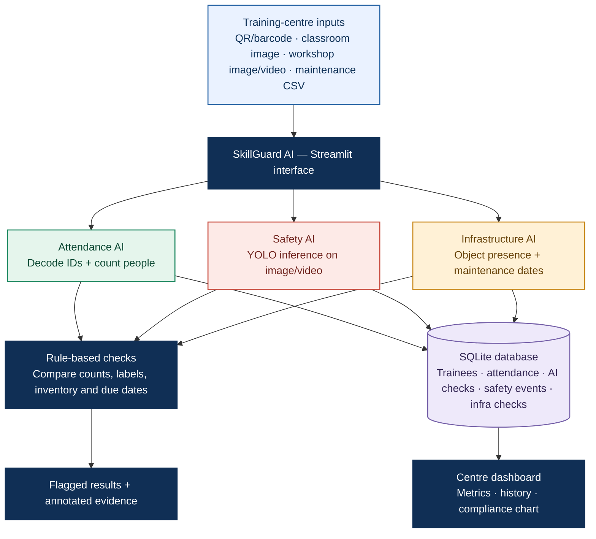

<div align="center">

# 🛡️ SkillGuard AI
### AI-Based Real-Time Monitoring of Training Centres for Attendance and Infrastructure Compliance

**Smart India Hackathon 2026 · Problem Statement SIH26245 · Team YUKTI**

<p>
  
  
  
  
</p>

**One monitoring workspace. Three AI-assisted modules. Evidence-led inspection.**

</div>

---

## 📌 Project Overview

SkillGuard AI is a prototype for **SIH 2026 Problem Statement 26245: “AI-Based Real-Time Monitoring of Training Centres for Attendance and Infrastructure Compliance.”** It brings attendance verification, visible safety-equipment checks, and infrastructure/maintenance checks into one monitoring interface.

Training centres may be inspected only periodically, while attendance records, equipment availability, and safety conditions can change between inspections. SkillGuard AI is designed to help reviewers focus on **flagged discrepancies and recorded evidence** rather than manually reviewing every record or piece of footage.

> **Prototype status:** This repository contains a Streamlit demonstration using image/video uploads, YOLO-based object detection, and a local SQLite database. It is not yet a validated, continuously connected multi-centre deployment. Results depend on the selected model, input quality, and configuration.

## 🎯 Problem Statement

**SIH ID:** `SIH26245`  
**Title:** AI-Based Real-Time Monitoring of Training Centres for Attendance and Infrastructure Compliance  
**Category:** Software  
**Team:** YUKTI

The proposed solution targets four practical gaps:

- **Attendance discrepancies:** QR/barcode scans alone do not prove that all marked trainees are physically present.
- **Safety compliance:** Visible PPE and safety-equipment issues can go unnoticed when footage is only reviewed after an incident.
- **Infrastructure availability:** Required equipment may be missing or inconsistent with approved records.
- **Maintenance follow-up:** Service intervals can be missed without clear due-date and overdue status.

## ✨ Key Features

<table>
<thead>
<tr><th align="left">Module</th><th align="left">Capabilities in this prototype</th><th align="left">Output</th></tr>
</thead>
<tbody>
<tr>
<td><strong>🟢 Attendance AI</strong></td>
<td>Trainee registration; QR/barcode image decoding; manual ID entry for demos; duplicate/unknown ID checks; classroom person counting; comparison of marked attendance with detected headcount.</td>
<td><code>OK</code>, <code>PROXY RISK</code>, or <code>UNREGISTERED</code> for review.</td>
</tr>
<tr>
<td><strong>🔴 Safety AI</strong></td>
<td>YOLO-based image analysis; video processing with configurable frame skipping; counts detected classes/persons and labels treated as PPE violations; compliance estimate and video timeline.</td>
<td>Annotated image, detected items, violation count, estimated compliance percentage, and sample violation frame.</td>
</tr>
<tr>
<td><strong>🟠 Infrastructure AI</strong></td>
<td>Checks selected expected objects against detections in a lab/workshop image; reads maintenance CSV data; calculates service due dates and maintenance status.</td>
<td>Detected objects, potentially missing expected items, and `OVERDUE`, `DUE SOON`, or `OK` maintenance status.</td>
</tr>
<tr>
<td><strong>🔵 Centre Dashboard</strong></td>
<td>Summarises recent attendance checks, safety events, infrastructure checks, and today's marked attendance for the selected centre.</td>
<td>Metrics, tables, and a safety-compliance chart backed by local records.</td>
</tr>
</tbody>
</table>

### 🧭 End-to-end flowchart



### 🎨 Module colour key

| Colour | Module / purpose |
|---|---|
| <span style="color:#16845B">🟢 Green</span> | Attendance AI |
| <span style="color:#C7473A">🔴 Red</span> | Safety AI |
| <span style="color:#C88718">🟠 Amber</span> | Infrastructure AI |
| <span style="color:#2764A5">🔵 Blue</span> | Platform workflow and dashboard |
| <span style="color:#7560A8">🟣 Purple</span> | Local data storage |

## 🧠 How Each Module Works

### 1. Attendance AI

1. Register a trainee with an ID, name, batch, and centre.
2. Upload a QR/barcode image or enter the trainee ID manually for demonstration.
3. The application checks whether the trainee is registered and whether attendance has already been marked for that date.
4. Upload a classroom image. The YOLOv8 nano COCO model counts detected people.
5. The system compares the number of marked trainees with the detected headcount, using a tolerance of one person.

| Rule | Result |
|---|---|
| Marked count exceeds detected count by more than the tolerance | `PROXY RISK` |
| Detected count exceeds marked count by more than the tolerance | `UNREGISTERED` |
| Counts are within the tolerance | `OK` |

**Important:** These are discrepancy flags, not proof of fraud. Camera angle, occlusion, image quality, timing differences, and detection errors can affect the result. A reviewer should verify alerts before taking action.

### 2. Safety AI

- Accepts a workshop image or video.
- Runs YOLO inference using the configured weights file.
- For video, samples frames according to the selected frame-skip value and plots estimated compliance over processed frames.
- Displays annotated detections, detected persons, violation count, estimated compliance, and a sample frame when a violation is detected.
- Logs analysis results in SQLite.

**PPE model requirement:** For meaningful PPE compliance results, provide a compatible, PPE-trained YOLO model named `best.pt` or specify the correct weights path in the sidebar. The current code falls back to `yolov8n.pt` if the configured weights file is not found. The fallback is a general COCO model and **does not reliably detect hardhats or safety-vest compliance**. The compliance figure is only as reliable as the model's classes and detections.

### 3. Infrastructure AI

- Select the equipment expected to be visible in the lab/workshop image.
- The model detects objects and compares the detected class names with the expected list.
- Upload a maintenance CSV with the columns shown below, or use the sample rows built into the demo.
- The app calculates the next due date from `last_service + interval_days`.

**Maintenance CSV format**

```csv
equipment_id,name,last_service,interval_days
EQ1,Lathe,2026-05-01,90
EQ2,Welding set,2026-09-20,60
EQ3,CNC,2026-07-15,30
```

The sample equipment detector uses classes available in the selected model. Custom industrial equipment generally requires a suitable trained model and class mapping. An object not detected in one image is treated as **potentially missing from that image**, not definitive proof that the equipment is absent from the centre.

### 4. Centre Dashboard and data storage

The dashboard shows recent attendance AI checks, safety events, infrastructure checks, today's attendance count, and a safety-compliance chart. The local SQLite database stores trainee records, attendance, attendance verification checks, safety events, and infrastructure-check logs.

## 🏗️ Current Prototype vs. Proposed Direction

The SIH concept describes a wider monitoring architecture, including edge processing, camera-integrity checks, privacy-preserving alert evidence, offline queueing and later synchronisation, role-based access, and a multi-centre inspector dashboard.

**Those broader capabilities should be treated as proposed design goals unless separately implemented and tested.** The current codebase is a local Streamlit demo with file uploads and SQLite. It does not currently implement continuous CCTV ingestion, ByteTrack tracking, camera-tampering detection, a distributed edge/server architecture, role-based authentication, automatic offline synchronisation, or a React/FastAPI/PostgreSQL deployment.

## 🧰 Technology Stack

| Technology | Use |
|---|---|
| Python | Application and module logic |
| Streamlit | Interactive web interface |
| Ultralytics YOLOv8 | Object/person detection |
| OpenCV | Image handling and QR/barcode decoding |
| NumPy | Image-array processing |
| Pandas | Tables, CSV input, maintenance calculations, event data |
| Plotly | Dashboard charting |
| SQLite | Local persistence |

The implementation currently uses **Streamlit + SQLite**. FastAPI, React, PostgreSQL, ONNX/TensorRT, multi-object tracking, and distributed edge processing appear in the proposed SIH technical direction, but are not part of the current runnable implementation described by these files.

## 📁 Repository Structure

```text
skillguard/
├── app.py             # Streamlit UI: dashboard and three AI modules
├── engines.py         # QR/barcode, person-count, PPE and equipment logic
├── db.py              # SQLite schema and database operations
├── run.py             # Launches Streamlit
├── requirements.txt   # Python dependencies
└── README.md          # Project documentation
```

At runtime, SQLite creates `skillguard.db` in the working directory. Keep the database and uploaded private data out of public commits if they contain real trainee or centre information.

## ⚙️ Installation and Setup

### Prerequisites

- Python 3.10 or a compatible Python version supported by the installed dependencies.
- Internet access for initial dependency/model downloads where required.
- A PPE-trained YOLO weights file (`best.pt`) for meaningful PPE-specific detection.

### 1. Clone the repository

Replace the placeholder with your actual GitHub repository URL:

```bash
git clone https://github.com/<YOUR-USERNAME>/SkillGuard-AI.git
cd SkillGuard-AI/skillguard
```

If you downloaded the source ZIP instead, extract it and open a terminal inside the `skillguard` directory.

### 2. Create and activate a virtual environment

**Windows PowerShell**

```powershell
py -m venv .venv
.\.venv\Scripts\Activate.ps1
```

**macOS / Linux**

```bash
python3 -m venv .venv
source .venv/bin/activate
```

### 3. Install dependencies

```bash
python -m pip install --upgrade pip
pip install -r requirements.txt
```

### 4. Add model weights (recommended)

Place the compatible PPE-trained `best.pt` in the `skillguard` directory, beside `app.py`, or enter the appropriate path in the application sidebar. If it is absent, the code uses `yolov8n.pt` as a fallback for the demo.

### 5. Run the application

```bash
python run.py
```

Open the local URL printed by Streamlit, normally:

**http://localhost:8501**

You can also launch directly:

```bash
python -m streamlit run app.py
```

## 🧪 Suggested Demo Walkthrough

1. Open **Attendance AI** and register a few fictional trainees with unique IDs.
2. Mark attendance using the matching IDs through a QR/barcode image or the manual demo field.
3. Upload a classroom image and compare the marked count with the model's detected people.
4. Open **Safety AI** and upload a workshop image or short video. Use a compatible PPE model to demonstrate PPE-specific labels.
5. Open **Infrastructure AI**, select expected objects, and upload a lab/workshop image.
6. Upload a maintenance CSV or review the sample maintenance records.
7. Return to **Dashboard** to review the saved attendance checks, safety events, and infrastructure logs.

Use fictional data or consented demo material. The suggested walkthrough demonstrates application logic; it does not validate accuracy under real operating conditions.

## 🔐 Privacy, Safety and Responsible Use

- Use test or appropriately authorised data in demos.
- Avoid committing real trainee details, private footage, credentials, API keys, or database files.
- Treat detections and discrepancy labels as decision-support signals, not final findings.
- Have a human reviewer validate potential attendance fraud, PPE violations, and missing-equipment alerts.
- Establish access controls, retention periods, consent/notice processes, and applicable legal safeguards before any real deployment.
- The current prototype does not implement face recognition. Do not interpret this as a complete privacy/security certification.

## ⚠️ Known Limitations

- Attendance headcount is image-based and may differ from the actual number of trainees due to occlusion, framing, and detection errors.
- QR/barcode decoding depends on image quality and OpenCV decoder support; manual ID entry is provided for demo use.
- PPE compliance requires a model trained with the relevant PPE classes. The fallback model is not a substitute for one.
- Compliance is estimated from detected class labels and should not be treated as a certified safety score.
- Infrastructure checks depend on the chosen model's available classes and image visibility.
- Maintenance status is calculated from the uploaded CSV and the computer's current date.
- The app is a local prototype, not a production-hardened multi-centre service.

## 🗺️ Development Roadmap

- [x] Streamlit interface with dashboard and three module tabs
- [x] Trainee registration and attendance records in SQLite
- [x] QR/barcode decoding and person-count discrepancy flags
- [x] Image/video PPE analysis workflow
- [x] Expected-object checks and maintenance CSV status calculation
- [ ] Evaluate and document models against representative training-centre data
- [ ] Add a validated PPE-specific model and robust class mapping
- [ ] Add camera-integrity and multi-frame tracking capabilities
- [ ] Implement secure user roles, audit controls, and configurable retention
- [ ] Evaluate edge deployment, offline queueing, and synchronisation
- [ ] Pilot with authorised centres and measure performance before scale-up

## 📚 References

The SIH presentation identifies the following background references and resources:

1. Ministry of Skill Development and Entrepreneurship / NSDC — PMKVY 4.0 Guidelines: https://nsdcindia.org/sites/default/files/PMKVY%204.0%20Guidelines.pdf
2. Comptroller and Auditor General of India — Performance Audit Report No. 20 of 2025: https://cag.gov.in/en/audit-report/details/123641
3. Redmon et al. — *You Only Look Once: Unified, Real-Time Object Detection* (CVPR 2016): https://arxiv.org/abs/1506.02640
4. Zhang et al. — *ByteTrack: Multi-Object Tracking by Associating Every Detection Box* (ECCV 2022): https://arxiv.org/abs/2110.06864
5. Shao et al. — *CrowdHuman: A Benchmark for Detecting Human in a Crowd*: https://arxiv.org/abs/1805.00123
6. Lin et al. — *Microsoft COCO: Common Objects in Context* (ECCV 2014): https://arxiv.org/abs/1405.0312
7. Government of India — Digital Personal Data Protection Act, 2023: https://www.meity.gov.in/
8. Smart India Hackathon — official portal and Problem Statement 26245: https://sih.gov.in/

## 👥 Team

**Team YUKTI** · Smart India Hackathon 2026 · Problem Statement `SIH26245`

---

<div align="center">

**SkillGuard AI — turning raw centre data into reviewable signals for safer, more accountable training centres.**

<sub>Prototype for demonstration and evaluation. All alerts require context and human verification.</sub>

</div>
